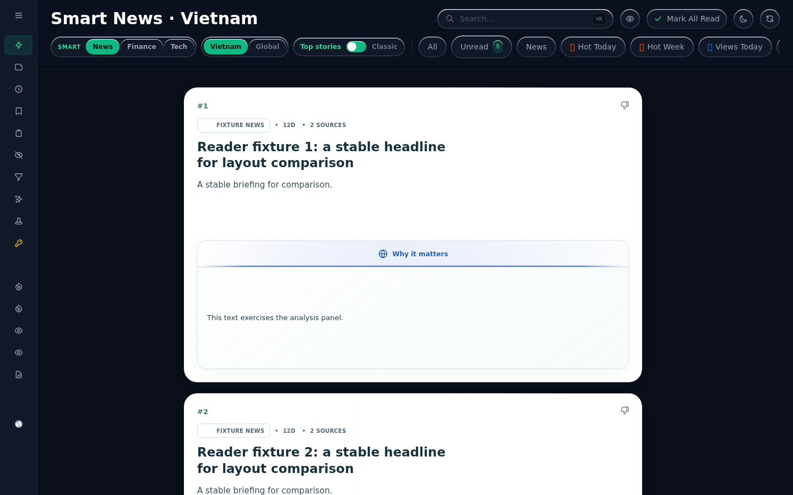

# RSS reader flashing investigation — 14 October 2026

This is a continuation of `PERFORMANCE_CONTINUATION_2026-10-14.md`. The original intermittent incident has no timestamp or recording. Controlled reproduction establishes two independent defects; it does not establish that every reported flash has the same cause. Overall performance/OOM acceptance remains incomplete.

## Method and scope

Read the attached requirements, current report, working-tree status, repository instructions, live health/resource data, frontend module manifest, request/pagination/navigation/restore paths, server events, article overlay ownership checks, Smart polling, image-focus/mutation/thumbnail modules, persistence/cache ownership, and existing experiments/tests. Existing unrelated changes, VOZ behavior and the October 14 normal-feed identity fix are preserved. No visual design or CSS changes were made.

The fixture server composes the actual production HTML, card partials and JavaScript. Eight fixed articles, fixed image bytes, fixed viewport and themes isolate card identity from changing live content. A captured pre-change bundle provides the baseline. Frame callbacks record reactive article identity, DOM reuse, image source/readiness, card bounds and scroll. Chromium screencasts capture actual intermediate frames. These diagnostic runs are separate from ordinary timing runs. Headless/mobile emulation and synthetic content limit conclusions about a user's physical browser and live workloads.

## Confirmed defects and fixes

### Smart Top authoritative revalidation remounts unchanged cards

`ReaderFeedRequests.fetchData(false, true, true)` preserves ordinary-feed objects, but its Top branch assigned newly parsed objects. WeakMap-based `articleRowKey` therefore changed for every card. The existing October 14 fix is sufficient for the tested normal-feed revalidation path, but deliberately did not cover Top.

Before: all eight Smart cards remount; after: all eight matching cards retain their objects, keys and DOM nodes. Actual captured baseline frames show the loaded thumbnail disappearing and returning, while headline/article identity remains correct. This is DOM replacement plus image reset, not evidence of another article appearing or a GPU defect.

`public/js/smart/refresh.js` now reconciles unambiguous cluster identities (exact link fallback only when no cluster ID exists). It applies fresh server fields to retained objects. Incoming order and membership remain authoritative: new stories enter, removed stories leave, ordering changes are honored. Missing or duplicate identities are not forcibly reused. Normal-feed alias semantics and its existing `Object.assign(existing, refreshed)` fix are unchanged.

### Older briefing poll overwrites a newer pushed completion

The existing SSE/viewport update path rejects an evaluated → queued briefing downgrade. The independent five-minute polling path used unconditional `Object.assign`, bypassing that protection. Deterministic delayed-JSON replay reproduces evaluated → queued after a newer pushed completion. The fixed path retains the newer briefing for the same material revision, while still updating other metadata and permitting genuine new-material briefings.

The polling implementation moved out of the long Top module into `public/js/smart/refresh.js`. It captures destination, token, list generation, region and filter context. Obsolete success/failure completions cannot mutate a new view or replace its timer. The existing scheduler remains in use; there is no competing navigation or request queue.

## Automatic UI-update inventory

“Can change” below is a capability, not a finding that the change is erroneous. Real membership changes, updated text and normal transitions may legitimately change layout.

| Path | Trigger / frequency | Visible state / identity behavior | Hidden/overlap/ownership behavior |
|---|---|---|---|
| `app/bootstrap.js` cache restoration | Startup, reload/tab eviction | Restores cached arrays, route and page; repeated scroll restoration at next tick/50/200/500 ms | Cache mismatch requests fresh destination; this is separate from ordinary tab return |
| `feeds/requests.js` revalidation | Restored cache after 50 ms; filter/server events | Updates cards, preferences, counts and loading state; normal-feed membership preserved; Top membership authoritative | Skips while list/page loading; abort plus generation guards; new Top reuse fix |
| `smart/refresh.js` polling | Normally 300 s; briefing event can schedule after 500 ms; hidden retry 60 s | In-place metadata/briefing changes, update availability | Hidden page defers fetch; generation/context guard now covers completion and rearming |
| `app/server-events.js` user-state | SSE, arbitrary arrival | Read/saved/board/hidden arrays and recent order; preference can change theme/hide-read | Hidden events ignored, reconciled on visibility; pending local mutations protected |
| Server content-filter events | SSE | Keywords then keep-visible list refresh | Visible only; save-in-progress guard; list generation ownership |
| Server board-cache events | SSE | Cache state, user state and Board refresh | Visible only; cache membership path can request a full list refresh; not comprehensively temporally reproduced here |
| Smart briefing SSE/viewport | SSE and heartbeat completion | Briefing object changes on existing matching card | Material version and evaluated-status guards; token checked on viewport events |
| `smart/viewport-priority.js` | Scroll/resize/visibility and interval heartbeat | Viewport priority and returned briefings | Scoped view token; can coexist with the poll (race reproduced and fixed) |
| Bootstrap user-state fallback | 300 s when SSE disconnected | Read/saved/hidden/preference reconciliation | Visible only |
| Bootstrap cache status | 60 s and login state change | Board badges/membership; potentially Board list | Does not universally gate on hidden state |
| Source clock | 30 s and visibility | Dates/source-time text | Can run idle and hidden (browser timer throttling applies) |
| Visibility/pageshow | Tab return / BFCache restoration | Sync status and user state | Ordinary tab return does not restore an old scroll position |
| Feed synchronization UI | Manual refresh; progress every 450 ms | Progress indicator and final list fetch | Final full refresh intentionally replaces membership; distinct from background cache revalidation |
| Prefetch | Delayed after list/hover/article navigation | Primarily cache data; VOZ freshness has its own background path | Existing prefetch ownership/cancellation retained |
| Article overlay | Fetch/cache return; progress every 400 ms | Content, title, loading indicators, scroll/history | Main content completion checks overlay request ID before and after JSON; no overlay logic changed |
| VOZ reader | Freshness completion, post restoration | New-post notice, page/content/position updates | Separate thread/page/request ownership; existing tests retained |
| Image loading | Lazy/intersection activation; load/error | Image source, placeholder/fallback, decoded image | Source changes can reset focus; real source updates must still display |
| Image focus | Mutation/resize/intersection/load; 2.5 s fallback | Focal geometry, tint, masks and blend styles | Async focus checks source, node identity, connection and stopped state; detached nodes unobserved |
| Image mutation collection | DOM/text/source/class/style mutations | Re-measures relevant photos; excludes own photo style writes | No broad scheduling/debounce changes made |
| Theme/responsive CSS | Local/server preference; resize; font/image readiness | Whole-page color/blur, sidebar/header/sticky/overlay layout | Genuine appearance changes are expected; no compositor workaround introduced |
| Embeds/late article media | External scripts, iframe/image load | Reading-view media and layout | Same-task overlay stress produced Alpine transition rejections; rendered open/back checks are reported separately |
| Persistence | Debounce, pagehide/freeze and state saves | Storage/cache snapshots; not normally a list replacement itself | No new cross-tab `storage` listener was identified in inspected client modules; SSE handles server cross-device state |

The main feed, card contents/photos/backgrounds/analysis, navigation/header/sidebar, loading indicators and article overlay were included in source/DOM inspection. Temporal visual proof is strongest for card revalidation. It is not comprehensive proof for every overlay, sticky/composited surface or every automatic backend publication phase.

## Optional diagnostics

`public/js/ui/flicker-diagnostics.js` is not imported by the application. It has zero runtime activity until explicitly installed. To enable it in the browser console:

```js
const { installFlickerDiagnostics } = await import('/public/js/ui/flicker-diagnostics.js');
installFlickerDiagnostics();
```

After a suspected flash, call `__readerFlicker.mark()` and `__readerFlicker.download()`. `__readerFlicker.export()` returns the recent evidence; `__readerFlicker.stop()` removes observers/listeners/timers and restores wrapped methods/fetch. Reload also removes it. No manual video recording is required.

The ring holds at most 1,024 events, each at most 768 serialized characters, with at most 60 seconds of exported history. Busy periods can shorten the retained interval. Oversized records are dropped and counted. No feed serialization, article bodies, raw headlines, URLs, search strings, cookies or credentials are exported. IDs/text/source values are local fingerprints, not cryptographic anonymization. Timestamps use `performance.now()`.

It records card insertion/removal/movement/change, object/key/node/destination fingerprints, source/focus attributes, image load/error, request headers/failure/obsolete generation, method boundaries, state/array identity, visibility/history/window lifecycle, available long-task/layout-shift entries and timer delays. It does not continuously capture screenshots or read geometry on every animation frame. Mutation work is bounded per delivery; overflow is reported. It cannot itself prove a paint-only defect or reconstruct every intermediate state missed between scalar samples. Engine-specific performance entries may be unavailable.

## Decisions and rejected changes

No opacity hiding, arbitrary delays, extra overlays, disabled features, frozen publication, global debounce, observer deferral, blanket layer promotion, GPU disabling, CSS redesign or heap-limit increase. No production GC or heap snapshot. Previously rejected image-focus experiments were not reapplied. No speculative cache/persistence change was shipped based on a short resource sample.

## Validation and measurements

Completed results and activation evidence follow. Raw temporary evidence is under `/tmp/rss-flicker-20261014`; selected durable scalar/visual evidence is saved in `docs/flicker-2026-10-14`.

### Temporal rendering evidence

Desktop and mobile Chromium, Classic and Glass: Top baseline retained 0/8 nodes after revalidation; candidate retained 8/8. The corrected descendant-aware mutation counter measured 8 removals + 8 insertions for baseline Top and zero of either for candidate Top. Ordinary feeds retained 8/8 throughout. Frame counts varied with rendering workload; missing frames are not evidence of absence of a transient.

Linux WebKit with an iPhone viewport also retained all eight cards for both feed and Top in both themes, with zero recorded removals/insertions and no page errors in those replays. This is not physical iOS Safari evidence. The installed engine was found under `/tmp/rss-webkit`; the default Playwright cache did not contain it.

Card bounds and scroll values remained identical across every sampled frame of the desktop revalidation runs, before and after. No wrong article identity was observed. The fixed Glass before/settled screenshot comparison had zero differing channel bytes. Classic had 165 differing channel bytes, all inside navigation coordinates x=835–993/y=64–92; the card area was identical. This does not claim every intermediate compositor frame was sampled.

The baseline Classic filmstrip visibly demonstrates the thumbnail failure:

| Loaded | Transiently blank | Loaded again |
|---|---|---|
|  |  |  |

[Fixed Glass appearance](flicker-2026-10-14/glass-fixed.png). The baseline's actual DOM replacement explains these pixels; no paint-only or GPU-specific defect was established. No claim is made that WebKit compositor behavior or physical iOS is fully validated.

### Memory, OOM, CPU and disk

Live sampling: seven process observations over 60.237 seconds, one PID. RSS ranged from 3,956.4 to 3,969.5 MiB. Only two distinct `/api/resources` timestamps were present (the endpoint caches minute samples); their heap values were 2,212.2 and 2,164.6 MiB, external memory 572.3 and 569.8 MiB. Smart refresh was active in both: these are not quiescent memory floors. Reported CPU was 12%/18%, interval event-loop p95 21.18/24.17 ms, maximum stalls 637.01/2,797.60 ms. [Scalar evidence](flicker-2026-10-14/resources-summary.json).

The physical process write counter increased **472.859 MiB** in that sample. Process accounting can include reaped children; this does not uniquely attribute reader code, providers, or device writes. A separate overlapping 60-second file watcher saw a 44,333,092-byte prefilter-state revision, 11,098,597-byte personal-filter revision, 470,154-byte fetch-statistics revision, two 308,644-byte cache-members revisions, article-cache files and small manifests. File sizes are not syscall or physical-write bytes, and the windows differ. [File-revision summary](flicker-2026-10-14/disk-summary.json). No overall write reduction is claimed.

Two isolated ownership experiments completed without touching live state:

* The existing publication-history replay retained **one generation** on all five cycles; heap settled around 63.2 MiB. This provides no new evidence against the previously repaired publication owner. [Evidence](flicker-2026-10-14/publication-retainers.jsonl).
* The new read-only snapshot/overlay replay loaded the current 111 MiB main and 197 MiB Smart snapshot files plus current keyed overlays. Actual stored-value and parsed-cache modules were used. Four completed parse cycles had heap floors **149.871 / 149.881 / 149.882 / 149.891 MiB**, with four strong parsed-cache entries. Clearing that cache reduced heap to **3.564 MiB**. About 292.8 MiB of raw buffer backing remained separately owned. RSS remained elevated despite released heap, illustrating why RSS alone cannot establish a retained-JavaScript leak. [Checkpoints](flicker-2026-10-14/state-owners.json), [stored-value sizes](flicker-2026-10-14/state-owners.json.sizes.json).

Diagnostic GC ran only in those isolated processes. The snapshot experiment does not execute complete live RSS/AI/embedding/publication workloads, and does not identify the retaining owner of the live OOM. No production snapshot, forced GC, heap-limit change, persistent-state deletion, provider-history edit, or persistence-policy change occurred. The P0 remains unresolved.

### Navigation and cached-article stress timings

The following ordinary browser samples used the same eight-card fixtures, image bytes, desktop viewport and ABBA variant order, eight samples per cell. However, they overlapped the full suite and variable shared-host/background activity. They are **stress observations, not matched workload evidence of end-to-end improvement**. They must not be compared directly to the earlier live 40-card measurements. All measured cached article samples contained readable content.

Each cell is median / p75 / p95 / maximum, milliseconds:

| Scenario | Baseline | Candidate |
|---|---:|---:|
| Classic feed navigation | 1063.4 / 1875.3 / 2501.8 / 2501.8 | 739.3 / 1461.7 / 1857.8 / 1857.8 |
| Classic Top navigation | 1040.8 / 1986.2 / 2951.2 / 2951.2 | 1464.2 / 2009.3 / 2553.1 / 2553.1 |
| Classic cached article | 654.5 / 985.9 / 2070.3 / 2070.3 | 889.3 / 1167.1 / 1786.2 / 1786.2 |
| Glass feed navigation | 3948.8 / 5265.9 / 10996.8 / 10996.8 | 3433.5 / 3663.8 / 7540.5 / 7540.5 |
| Glass Top navigation | 4046.9 / 6706.1 / 7095.3 / 7095.3 | 3664.3 / 4281.7 / 6056.0 / 6056.0 |
| Glass cached article | 1375.6 / 2249.1 / 3118.6 / 3118.6 | 1283.9 / 1395.3 / 2985.0 / 2985.0 |

These variable results do not meet the cached-article target or prove a broad navigation improvement. No cached-reader implementation was changed. [Full scalar distributions](flicker-2026-10-14/stress-timings.json).

### Scope matrix and remaining gaps

| Requested scenario group | Evidence in this continuation | Limits |
|---|---|---|
| Idle page | Controlled repeated automatic revalidation; source inventory includes all major timer/SSE/observer paths | One-minute fixture observations are not a long production soak or a complete scheduled RSS/Smart generation |
| Navigation | Deterministic late feed response; pending briefing JSON; destination/generation/filter/mode changes; article open/back | Personal-filter updates concurrent with pagination and every route-restoration combination not exhaustively replayed |
| Scrolling | Repeated down/up around background updates and article loops; card identity/frame geometry | Eight-card fixture, not every long-feed/image-density combination |
| Browser lifecycle | Resize/viewport checks, lifecycle diagnostics; existing browser lifecycle tests | Native minimize/restore, long-hidden-tab behavior and every BFCache/offline combination not newly proven |
| Async operations | Forced completion order, actual request-generation checks, push-versus-poll race, ordinary image lifecycle | No exhaustive matrix of every image decode/error/fallback and every source provider |
| Longer observation | Bounded diagnostic ring and short idle/loop observations | No hours-long UI soak or quiescent completed live-job memory floor |
| Platforms | Desktop/mobile Chromium and Linux WebKit iPhone viewport, both themes | Physical iOS Safari and hardware-specific GPU behavior unavailable |

No reproduced wrong-article substitution was observed in the checked frames/races. This is narrower than a guarantee that it never occurs. The confirmed thumbnail blanking mechanism is fixed in the tested Top revalidation path; other whole-page paint artifacts remain unproven.

### New regressions covered

`test/smart-refresh-identity.test.js` covers authoritative ordering/removal/insertion, object reuse, ambiguous/missing identities, changed cluster identity despite a shared URL, delayed polling versus pushed completion, changed material versions, stale generation/destination/filter/mode, full-publication briefing downgrade, and omitted thumbnail/metadata removal. `test/flicker-diagnostics.test.js` covers ring volume/age limits, oversized payload rejection, method/fetch cleanup and absence of raw article identifiers/headlines in exported evidence. Existing normal-feed identity, pagination, request recovery, image, source and VOZ tests remain present.

`flicker-replay.mjs`, `briefing-race-replay.mjs`, `flicker-scenarios.mjs` and `smart-refresh-benchmark.mjs` reproduce transitions against the production component assembly. The existing image-observer probe now accepts a captured bundle and Smart revalidation mode. These remain diagnostic modules, not production polling.

### Rollback

`flicker-2026-10-14/integration.patch` contains only this continuation's request/poll wiring, client-module registration and script-version changes. `git apply -R --check docs/flicker-2026-10-14/integration.patch` passed. If rollback is necessary, reverse that scoped patch, restart `rss-reader` because the module manifest is imported at startup, and verify health/served assets. Leave unrelated working-tree changes intact. The unused new helper and opt-in diagnostic files can safely remain after rollback; no persistent data migration needs reversal.

### Unresolved acceptance and next work

1. **P0 OOM:** capture retaining paths in a representative isolated full RSS/Smart/AI workload, including job completion and overlap. The current snapshot/cache replay rules out unbounded growth only for the measured isolated owner, not the running application.
2. **Navigation/cached-reader latency:** the multi-second stress observations remain unacceptable. Repeat live 40-card measurements with controlled background activity, then attribute fetch-continuation/post-assignment delay and cached-overlay paint. Do not infer success from the small-fixture revalidation improvement.
3. **Physical I/O:** correlate longer physical counters with payload-suppressed, per-writer syscall attribution across complete refresh cycles. The prefilter/personal/statistics revisions are leads, not proof of the full 473 MiB sample's ownership.
4. **Intermittent flash:** use the optional bounded evidence capture during actual browsing; correlate a marked incident with node/image/context events before adding compositor or observer changes.
5. **Platform/coverage:** obtain physical iOS evidence and longer background/foreground/idle sessions. Board membership refresh, late article media, full-page translucent surfaces and unusual restoration paths still need targeted temporal tests if the original symptom persists.

No unresolved performance, OOM, physical-write or physical-iOS criterion is marked fixed.

### Complete-suite validation

Final release `npm test`: **789 passed, 0 failed, 0 skipped**, **247.339 seconds**, including the omitted-thumbnail regression and the diagnostic request-generation labeling check. Entry-point syntax checks included in `npm test` passed; changed frontend/helper modules also passed syntax checks. An earlier clean full run was 788/788 before that final regression was added.

For transparency: an initial concurrent run terminated with exit 143 without a final summary. The next concurrent run had 787 passes and one HTTP smoke-test startup timeout at about 30.7 seconds. Its isolated rerun passed in 5.9 seconds, and subsequent full runs with profiling stopped passed cleanly. An attempted test-process `ANTIGRAVITY_ENABLED=false` setting did not suppress all provider-startup activity inside the existing tests; it was not a production setting change.

The repository-wide whitespace check reports pre-existing changes in unrelated source adapters and `summary-engine.js`; those were not rewritten. The changed index integration passed its scoped diff check. No dependencies, Tailwind classes or CSS were changed, so no CSS rebuild was required.

### Final isolated browser results

With the full suite stopped, an ABBA eight-card Top revalidation experiment used identical content/images, viewport and themes, with eight samples per variant and no frame/mutation instrumentation. Host background work remained enabled, so this is a controlled fixture result, not a guarantee for live feed navigation.

| Top revalidation | Before median / p75 / p95 / max | After median / p75 / p95 / max |
|---|---:|---:|
| Classic | 158.5 / 170.3 / 204.8 / 204.8 | 57.4 / 59.9 / 68.0 / 68.0 |
| Glass | 328.8 / 371.1 / 371.7 / 371.7 | 68.7 / 69.9 / 79.2 / 79.2 |

[Timing distributions](flicker-2026-10-14/refresh-timings.json). This improvement concerns unnecessary background remount/render work, not full feed/Top switching or cached-article opening.

A separate Glass image-focus observer probe measured:

| Observer | Before callbacks / rectangle reads / time ms | After callbacks / rectangle reads / time ms |
|---|---:|---:|
| Mutation | 13 / 136 / 99.4 | 8 / 120 / 22.9 |
| Resize | 1 / 120 / 21.7 | 0 / 0 / 0 |
| Intersection | 2 / 240 / 30.0 | 0 / 0 / 0 |

Total measured rectangle reads fell 496 → 120. Remaining mutation-driven geometry work exists; it was not broadly deferred or disabled. These instrumented observer times are not ordinary navigation latency. [Observer evidence](flicker-2026-10-14/observers.json).

Final Chromium Top traces recorded one Layout event per theme, no LayoutShift or GC events in the captured transition, and expected paint/layer work. Classic Layout/UpdateLayoutTree/Paint durations were 2.369/11.758/2.577 ms; Glass 57.800/15.024/6.118 ms. Those are single diagnostic traces, not timing distributions or proof of compositor correctness on other hardware. [Summary](flicker-2026-10-14/trace-summary.json), [Classic trace](flicker-2026-10-14/classic-trace.json), [Glass trace](flicker-2026-10-14/glass-light-trace.json).

Both themes completed 12 automatic Top revalidations spaced by five-second waits (at least one minute each), without mouse/keyboard input: **zero replacements**, and **2,273 DOM elements before and after**. Forced out-of-order feed responses left the correct destination/content visible and retained all eight current cards. Five rendered article open/back cycles interleaved with scrolling/revalidation retained all eight feed nodes. Resize then switched the desktop viewport to 390×844. Both runs had zero page errors; diagnostic stop cleanup succeeded. Exported event counts were 494 Classic / 548 Glass. [Scenario evidence](flicker-2026-10-14/scenarios.json).

The exported history contained 8 Classic / 4 Glass layout-shift entries, all after the deliberate viewport resize and all marked recent-input; they are not zero-shift claims for the entire session. The pure revalidation frame bounds remained stable. Long-task counts (10/16) show work, not wrong frames.

An earlier artificial loop opened and closed cached overlays within the same JavaScript turn, without allowing the open view to render. Glass produced two uncaught Alpine transition promise rejections. The final loop allowed rendered frames between open/back actions and passed without rejections. No application animation timing was changed and no errors were suppressed. The same-turn stress exception remains a limitation; it is not established as the user's intermittent visual symptom.

Final Linux WebKit replay on the final application code again had zero removals/insertions, all eight nodes reused, and no page errors for feed and Top in both themes. [Final WebKit evidence](flicker-2026-10-14/webkit-release.json).

### Additional production OOM and activation status

Failure-only journal lines confirmed another **fatal JavaScript heap OOM at 14 October 13:33:47 Vietnam time** (06:33:47 UTC). Systemd restarted the process and raised `NRestarts` to 2. Before handoff, the replacement PID 3303765 was active/running but already reported heap **2,657.1 MB** and RSS **3,955.6 MB** after about 6h35 uptime. This is additional evidence that memory reliability is unresolved; no causal attribution to a particular cache or workload is made.

The automatic restart had already loaded the updated client-module manifest. At **20:09:52 Vietnam time**, a direct HTTP comparison verified that the served `/script.js` SHA-256 exactly equaled the current locally assembled tested bundle, including `ReaderSmartRefresh` and authoritative missing-field removal. Served HTML contained `20261014_flicker_1`; `/health` returned `ok`. No additional manual restart was necessary, and no restart-time memory drop is offered as evidence of improvement. [Activation evidence](flicker-2026-10-14/activation.json).

Existing browser tabs need a reload to receive the updated script. The optional diagnostic remains disabled unless explicitly installed.
