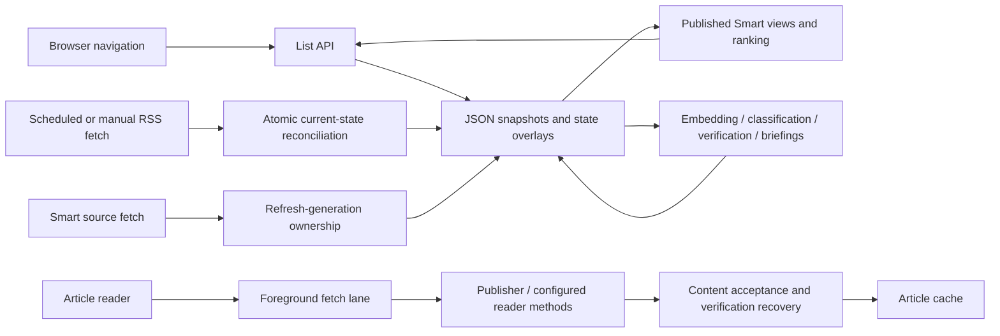

# RSS optimization, reader stability, and publisher recovery — 5 November 2026

Implementation is activated in the running service. The confirmed reader/navigation lifecycle defects, overlapping RSS publication race, and publisher cooldown recovery behavior have been repaired in focused modules. This report distinguishes controlled regression evidence from live measurements taken under changing background workloads.

## 1. Initial System Health

The application uses Node 24.20.0, Express 5, Alpine classic-script feature modules, Tailwind, and source-specific HTML readers. `src/app.js` wires the subsystem owners. The server composes HTML partials and browser modules through `src/ui/reader-assets.js`. This is a client-rendered application; there is no React reconciliation or hydration path to optimize.

The database stores serialized JSON snapshots with a bounded parsed cache, atomic file replacement, backups, and keyed overlays for frequent lightweight state changes. It is not a SQL database: index/query-plan recommendations would not apply. RSS fetching runs with five concurrent feeds and a ten-minute minimum background cycle. Smart fetching, clustering, embedding workers, verification, ranking and briefing generation have separate lifecycle/concurrency owners. Foreground article fetching has four slots; browser work has two. Browser processes are shared with the desktop and cannot all be charged to the RSS service.

The effective systemd configuration uses a 3,072 MiB V8 heap, 5 GiB memory-high threshold, 6 GiB maximum and a 120-second watchdog. These limits, model choices and scheduler intervals were preserved.

Execution flows:

A 306.8-second initial mixed-workload capture averaged **13.16% of one CPU core**, with process RSS **2,028.6–2,548.1 MiB**, heap **418.4–538.7 MiB**, no process swap, and **314.8 MiB** physical process writes. The live application already had readers/background work; a visitor-free production idle scenario was unavailable without disconnecting existing use. A separate 120.9-second quieter window averaged **13.12%**, with RSS **2,070.4–2,196.2 MiB**. These observations did not establish excessive CPU use or a memory leak. The host had approximately 2 GiB of swap occupied, but the observed RSS process had none.

Event-loop samples included long stalls: the initial maximum was **1,687 ms**. Histogram p95 values were generally approximately 21–29 ms with a 20 ms sampling resolution. Those histogram values are not browser interaction timings.

Repeated list requests returned roughly **0.6–0.7 MB decoded JSON**. List gzip already existed. The composed JavaScript response was **492,582 bytes without compression**, even when gzip was requested. Provider logs initially showed disconnected Gemini browser-profile failures and provider cooldowns; later provider availability changed independently of this work. No provider recovery or AI latency improvement is attributed to these changes.

A later two-minute file-event observation saw approximately 3.6 MB of thread-cache writes and no repeated main-snapshot rewrite in that window. The earlier large I/O bursts were not a steady write rate; startup and completed snapshot/backup cycles materially change the result.

## 2. Root Causes

1. **Reader data lifetime did not match transition lifetime.** Close cleared the article and rendered content while Alpine still owned panel/backdrop exit transitions. Delayed opening work could also outlive a close. Cleanup now follows an actual render/hide barrier.
2. **Ownership keyed by event proxy was unstable.** Real DOM clicks produced different Alpine evaluation proxies. A direct method test could pass while the same operation from another control missed its WeakMap owner. A frozen, non-enumerable per-component identity now joins those event contexts.
3. **Foreground refresh tore down valid lists.** Same-section selection and non-Top foreground refresh emptied the list before downloading its replacement. Returning data then created new article objects and rows. Exact-context retention and authoritative reconciliation now preserve eligible rows.
4. **History continuations were unguarded.** An older hash handler could await its list, then open an obsolete article after a newer destination had won. Route generations now guard that continuation.
5. **Cache-clear completion used mutable current-reader state.** A pending clear could reopen or modify a reader that had already closed or changed. Completion is now bound to its originating reader generation and URL.
6. **RSS work could overlap and publish old snapshots.** Manual and scheduled sync entered independently, then committed the feeds/articles captured before network work. This could resurrect removed feeds, overwrite edits, or lose newly added articles.
7. **Smart background ownership was checked too early.** A foreground refresh could start during destination work after the background batch's last check. Publication now checks a refresh generation inside the database queue.
8. **Publisher cooldowns had no accepted-success reset.** Retry cleared only the browser cache, allowing the server cache to satisfy the request. A valid live recovery did not durably reset the incident. The new reset also needs ordered mutation/persistence/rollback to avoid cross-publisher failure races.

The code paths and controlled replays confirm these defects. They do not establish a universal GPU/compositor cause for every historical flicker report.

## 3. Implemented Optimizations

### Frontend and modal/navigation

- `public/js/article/overlay-lifecycle.js`: cancels owned work immediately; retains rendered state and the background scroll lock until the root, panel and backdrop are hidden after Alpine's render/frame boundary. Reopening invalidates pending cleanup. Stack restoration remains supported.
- `public/js/article/overlay-request.js`: aborts obsolete reader transports while retaining request-ID guards.
- `public/js/article/route-transition.js`: rejects stale history continuations.
- `public/js/article/cache-refresh.js`: owns asynchronous cache-clear completion.
- `public/js/feeds/list-publication.js`: retains only the exact published filter context and reconciles unambiguous rows with authoritative incoming membership, order and field removal.
- `public/js/feeds/filter-transition.js`: extracts section transition logic. Clicking the current section still refreshes, resets pagination, clears the article route and scrolls to the top; cards remain visible while its response arrives.
- `public/js/app/component.js`: provides stable per-reader ownership across Alpine proxies.
- Existing feature files contain integration calls. `src/ui/client-modules.js` registers the new modules. The article-list scroll lock also covers the exit phase.

### Backend/API and networking

`src/middleware/shell-compression.js` adds negotiated gzip for the composed document and JavaScript. It shares in-flight compression and keeps a bounded cache of exact source bytes: four entries, at most 4 MiB accounted storage. Changed source bytes invalidate the representation. Existing no-cache revalidation, content types, validators, no-transform policy, list gzip and event streaming are preserved. No new application dependency was installed.

### RSS, database and storage

- `src/database/batch-writer.js` extracts the existing batch commit safety, backups, rollback and persistence behavior and adds synchronous `updateMany` under the existing database write queue.
- `src/feeds/coalescing.js` uses the existing job coordinator: one active sync and one merged pending batch per database. Progress subscribers survive coalescing. Explicit source requests retain their force semantics through `fetch-scope.js`, including recently fetched Macroeconomics sources.
- `src/feeds/publication.js` and `publish-results.js` reconcile fetched candidates against **current** feed membership, articles and saved/read/board/hidden state at commit. Current feed settings win; custom publisher metadata is preserved. Removed-source candidates are not admitted.
- `src/feeds/prefetch-targets.js` extracts the existing pure target selection so articles, state cleanup, inferred metadata and targets still use **one** snapshot commit. No second full write was introduced.
- Existing retention, deduplication, ordering and editorial rules remain in place. No user/history data was deleted for optimization.

This repairs sync's stale publication boundary. It does not claim that every unrelated legacy read-then-write mutation elsewhere in the application is now transactional.

### AI and reliability

`src/smart/background/publish-sources.js` owns post-fetch Smart work and checks refresh generation again inside the database queue. The coordination module advances that generation when foreground refresh begins. Obsolete batches cannot overwrite the newer refresh through the previously unguarded continuation. No model-selection, ranking, scheduler or fallback policy was changed.

### Publisher verification and cooldown reset

`src/articles/verification-recovery.js`, `cooldown-recovery.js`, and `cooldown-incidents.js` implement the added request:

- Retry bypasses browser and server caches.
- Accepted live foreground content resets only the matching publisher incident, including verification solved during the same browser attempt.
- The reset removes the pause and escalation history durably. A later failure starts at the base duration.
- Cached, partial, deleted, challenge and failed results cannot reset it.
- Incident identities prevent a late success from clearing a newer failure.
- One owner orders record/reset mutations, snapshots, persistence and rollback. A failed reset cannot disappear from storage when another publisher resets concurrently.

The existing Open original / Retry alert remains intact. No verification challenge was triggered or solved artificially against a real publisher.

## 4. Performance Comparison

Controlled comparisons:

| Scenario | Original | Repaired |
|---|---:|---:|
| Eight simultaneous full RSS refresh callers | 16 source fetches | 4 source fetches, **75% fewer** |
| Peak simultaneous fetches in that gated replay | 8 | 1 |
| Concurrent feed edit/add/delete and article addition | Lost/restored incorrectly | Preserved; removed-source articles excluded |
| Same-view foreground refresh, eight fixture rows | 0 rows while waiting; 0 reused | 8 while waiting; 8 reused |
| Older history continuation after newer navigation | Obsolete article reopened | Rejected |
| Live composed JavaScript representation | 499,224 decoded bytes | 99,673 transferred bytes, **80.0% smaller** |
| Gzip of the identical original JS bytes | 492,582 bytes | 97,591 bytes, **80.2% smaller** |
| Gzip of the identical original HTML bytes | 376,609 bytes | 63,066 bytes, **83.3% smaller** |

The eight-caller RSS replay took approximately **1.01 s before and 2.02 s after**. Pending callers now await a second serialized/coalesced run. This trades burst completion latency for bounded work and correct publication. It is not an overall throughput-speedup claim. Compression has a first-generation CPU cost; repeated unchanged shell requests share/reuse the result.

Live observations, **not normalized improvement claims**:

| Metric | Before | After |
|---|---:|---:|
| Quieter process CPU, one-core basis | 13.12%, 120.9 s | 11.18%, 122.2 s |
| Quieter process RSS | 2,070–2,196 MiB | 1,219–1,476 MiB |
| Quieter physical process writes | 281.0 MiB | 281.6 MiB |
| Repeated Today API total p50 / sample p95 | 269.7 / 1,213.3 ms | 343.8 / 1,248.1 ms |
| Same feed API total p50 / sample p95 | 221.8 / 650.2 ms | 285.4 / 3,716.9 ms |
| Smart Top API total p50 / sample p95 | 251.4 / 906.5 ms | 263.8 / 667.6 ms |

Each API view has eight repeated samples; its p95 is effectively the sample maximum. Payloads, provider availability, process uptime, visitors and background work changed between live windows. Some API totals were slower; no API latency improvement or causal CPU/heap reduction is claimed. The restart-induced memory drop is not leak-fix evidence.

The first six post-activation minutes included startup, RSS processing, Smart work, browser checks and tests: **22.17% one-core CPU**, **872–1,799 MiB RSS**, **914.8 MiB writes**, zero process swap and a **4,383 ms** maximum event-loop sample. This is a startup/workload observation, not a comparable steady-state baseline. Long event-loop stalls remain a meaningful opportunity.

RSS fetch duration/freshness and AI throughput were observed through existing status/job boundaries, but no matched full Smart/AI completion cycle was obtained. SQL query latency is inapplicable. Field LCP/INP/CLS, lab TBT, browser battery consumption, target-device GPU cost and public reverse-proxy behavior were not reliably measured; no improvements to them are claimed.

## 5. Flicker Fix Verification

Saved original assets and repaired assets were exercised using the real composed templates, Alpine and controlled fixture responses. Tests cover repeated close/reopen, same-view slow responses, authoritative row reuse, all six Smart destinations, out-of-order history continuations, real section-click event contexts, delayed image decoding, scrolling through background refresh and resizing an open reader.

The final Chromium and Linux WebKit matrices cover desktop/mobile viewport widths and Classic/Glass Light themes. Both engines report zero blank **visible panel** closing frames, stable retained rows, correct reopen behavior, no stale route reopening and no page errors in the tested core scenarios. Chromium's additional native-click/image/scroll/resize matrix also passed. Scroll position stayed at 300 px through refresh and image decoding; resizing retained the same readable panel.

Frame records distinguish root display, panel display/opacity, inline hide state, article content and scroll locks. Early diagnostics counted content-cleared root frames even when panel opacity was already zero; those counts are a lifecycle indicator, not proof of painted flicker. The final acceptance predicate checks visible panels. Root/child hide ownership, request generations and real-event identity are the underlying repairs; no arbitrary timing delay, blanket animation removal, blur removal or loading mask was used.

Live protected browser checks passed feed and Smart Top navigation and cached article opening in both themes, without changing saved/read/preferences. Tests on Linux software rendering cannot establish physical macOS Safari/iPhone smoothness or eliminate every browser/GPU-specific historical symptom. No field-wide “all flicker permanently impossible” claim is made.

## 6. Testing Results

**Final verification: `npm test` passed all 877 tests, with zero failures, cancellations or skips, in 288.0 seconds.** The command also completed the server and feed-worker syntax checks. Separate syntax checks passed for 28 changed application modules.

Focused coverage passed for database update isolation/rollback, one-commit publication, overlapping RSS scopes and failures, explicit forced refreshes, stale Smart publication, lifecycle ownership across proxies, route races, cache-clear races, Reddit external opening, authoritative reconciliation, compression negotiation/reuse/eviction, durable publisher recovery and the two-publisher failed-reset race. Existing parser, RSS fallback, pagination, source policy and ranking/editorial suites were also exercised.

One loaded full run completed **875/876 tests**, with the HTTP integration child exceeding its 30-second timeout during overlapping startup/browser workloads. Its isolated rerun passed in **9.85 seconds**. A subsequent 877-test run passed the HTTP integration check but exposed an existing 20 ms wall-clock race in a scheduler test (876 passed). Its isolated rerun passed. That test now uses the project's existing mocked-clock mechanism: it waits for queue admission, advances exactly 20 ms, and verifies the late callback cannot start AI. The final suite runs with that deterministic test. Neither application deadlines nor the HTTP timeout were extended. These transient failures remain in the record.

Final activation checks: the service is **active/running**, health is **OK**, 49 feeds are loaded, automatic restarts and cgroup OOM events are **zero** in the new window. The served JavaScript SHA-256 exactly matches the assembled local source. Raw HTTP conditional revalidation returns **304 with zero body bytes**; identity negotiation remains uncompressed. Final health at 15 minutes reported 1,890.1 MiB RSS and 378.8 MiB heap. Activation uses the existing service manager and required CSS build; these checks remain separate from long-term stability acceptance. The working tree was already extensively modified; unrelated source changes and removals were preserved. No commit or pull request was created.

## 7. Remaining Opportunities

1. **High:** trace the remaining live event-loop stalls during representative completed RSS/Smart cycles and full snapshot writes, with separate request queue, serialization, parsing, card preparation and provider timings. The short mixed windows do not establish which owner dominates every tail-latency spike.
2. **High:** obtain a representative long soak with completed Smart/AI boundaries and post-job memory floors. Initial provider disconnects/quotas and reading priorities affected the observed job duration. No long-term OOM/leak or AI-throughput acceptance is inferred from a healthy restart.
3. **Medium:** validate the repaired transitions and scrolling on the user's physical Safari/iPhone/desktop GPU and slow-network conditions. Linux WebKit plus Chromium emulation are useful regression coverage, not device acceptance.
4. **Medium:** migrate other legacy read-modify-write mutations to the atomic updater when those behaviors are touched. Sync publication is repaired; unrelated CRUD paths retain their existing ownership limitations.
5. **Medium:** collect field interaction/web-vital measurements before pursuing more rendering, asset-delivery or indexing changes. Repeated embedding text/key preparation was found, but its share of runtime was not measured and no speculative change was made.

Evidence: `activation.json`, `measurements.json`, `browser-before.json`, `browser-chromium.json`, and `browser-webkit.json` in this directory. Detailed temporary capture files and test logs remain under `/tmp/rss-optimization-20261105/`; they are not public repository artifacts.
